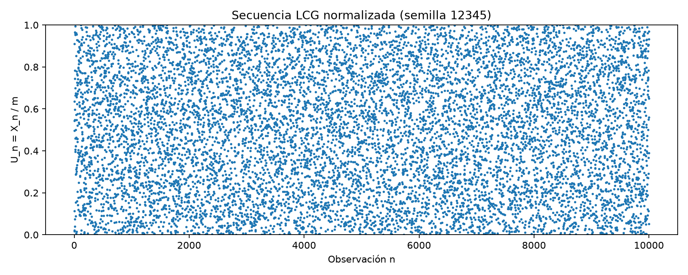

# APE 05: Generador Congruencial Lineal en Python y Java

## Objetivo

Comprender el funcionamiento de un generador pseudoaleatorio mediante el método LCG, implementar el mismo algoritmo en Python y Java y comparar sus secuencias y propiedades. Se revisaron las tres páginas de `ape_guia simulacion semana 5.pdf` (Práctica 05, guía Nro. 004).

## Algoritmo

```text
X_(n+1) = (a * X_n + c) mod m
U_n = X_n / m

a = 1664525
c = 1013904223
m = 2^32 = 4294967296
X_0 = 12345
```

Se generan 10 000 observaciones, desde X_1 hasta X_10000; la semilla X_0 no cuenta como observación. Los valores normalizados están en [0, 1). Java utiliza `long`: el mayor producto y suma posibles es 7149081450614098, que cabe en ese tipo. Python usa enteros de precisión arbitraria.

## Estructura

```text
APE05-LCG/
├── .gitignore
├── README.md
├── python/
│   ├── main.py
│   ├── generador_lcg.py
│   ├── grafica.py
│   └── requirements.txt
├── java/
│   ├── pom.xml
│   └── src/main/java/lcg/
│       ├── Main.java
│       └── GeneradorLCG.java
└── graficas/
    └── grafica_lcg.png
```

`main.py` coordina funciones de comparación y ejecución; `generador_lcg.py` contiene el algoritmo y `grafica.py` dibuja la secuencia. `Main.java` coordina métodos sencillos y `GeneradorLCG.java` mantiene el estado del generador. Se tomó como referencia la separación de responsabilidades de APE 3 y Práctica 4, sin incorporar sus simulaciones ni patrones.

`.venv/`, `python/__pycache__/` y `java/target/` son carpetas técnicas locales, excluidas por `.gitignore`. El JAR ejecutable queda en `java/target/lcg-java-1.0.0.jar`.

## Requisitos y ejecución en Ubuntu 24.04

Python 3 con `venv`, JDK 25 o superior y Maven. La única dependencia directa de Python es `matplotlib`; Java no tiene dependencias de aplicación externas. Maven descarga sus complementos de construcción en la primera compilación.

Si faltan las herramientas:

```bash
sudo apt update
sudo apt install python3 python3-venv python3-pip maven
```

Instala JDK 25 mediante una distribución compatible con tu versión de Ubuntu.

Preparación y compilación, desde Bash:

```bash
cd ~/Descargas/APE05-LCG-Modular/APE05-LCG
python3 -m venv .venv
source .venv/bin/activate
python -m pip install -r python/requirements.txt
cd java
mvn clean package
cd ..
```

Ejecutar Java de manera independiente:

```bash
java -jar java/target/lcg-java-1.0.0.jar
java -jar java/target/lcg-java-1.0.0.jar --semilla 54321
```

Cada ejecución Java calcula las 10 000 observaciones y muestra las primeras 20, con un resumen. El modo técnico `--semilla ENTERO --secuencia` envía las 10 000 filas `n X_n U_n` a la salida estándar para que Python las lea directamente.

Ejecutar el experimento completo (compilar el JAR primero):

```bash
python python/main.py
```

Python genera 10 000 valores con semilla 12345 y ejecuta el JAR con esa misma semilla mediante `subprocess`. Recibe la secuencia en memoria, muestra una tabla de las primeras 20 observaciones y compara exactamente las 10 000 tuplas `(n, X_n, U_n)`. Repite la comprobación con semilla 54321 y compara los estados de ambas semillas en las mismas posiciones. Si hay diferencias entre lenguajes, cantidad incorrecta o falla Java, termina con error.

El redondeo a diez decimales solo afecta la tabla de terminal. La comprobación utiliza los enteros y valores normalizados completos, sin tolerancia. Como m es una potencia de dos y X_n tiene como máximo 32 bits, los normalizados son representables exactamente en los tipos usados.

Solo se guarda `graficas/grafica_lcg.png`, con las 10 000 observaciones de la semilla inicial. Volver a ejecutar reemplaza esa misma imagen. Las secuencias y las tablas no se guardan en CSV ni se crea otra gráfica al cambiar la semilla.

## Resultados comprobados

Se ejecutaron `mvn clean package` (BUILD SUCCESS), el JAR con las dos semillas y el programa Python completo. Se verificaron además la recurrencia de los 10 000 estados, la normalización y ausencia de estados repetidos dentro de cada muestra; la imagen PNG se abrió y revisó visualmente.

Las pruebas se realizaron en este entorno con Python 3.14 y OpenJDK 25; el proyecto Maven compila para Java 25. Los comandos anteriores corresponden al entorno Ubuntu solicitado; no se afirma haber probado específicamente Ubuntu 24.04.

| Semilla | Valores Python | Valores Java | Coincidencias primeras 20 | Coincidencias completas | X_1 | X_10000 |
|---:|---:|---:|---:|---:|---:|---:|
| 12345 | 10000 | 10000 | 20/20 | 10000/10000 | 87628868 | 2793649609 |
| 54321 | 10000 | 10000 | 20/20 | 10000/10000 | 1238253532 | 3773716417 |

### Tabla comparativa de las primeras 20 observaciones (semilla 12345)

U_n se muestra aquí con diez decimales. La tabla se vuelve a calcular en terminal para ambas semillas.

| n | X_n Python | X_n Java | U_n Python | U_n Java | Coinciden |
|---:|---:|---:|---:|---:|:---:|
| 1 | 87628868 | 87628868 | 0.0204026857 | 0.0204026857 | Sí |
| 2 | 71072467 | 71072467 | 0.0165478482 | 0.0165478482 | Sí |
| 3 | 2332836374 | 2332836374 | 0.5431557945 | 0.5431557945 | Sí |
| 4 | 2726892157 | 2726892157 | 0.6349040561 | 0.6349040561 | Sí |
| 5 | 3908547000 | 3908547000 | 0.9100295138 | 0.9100295138 | Sí |
| 6 | 483019191 | 483019191 | 0.1124616691 | 0.1124616691 | Sí |
| 7 | 2129828778 | 2129828778 | 0.4958894053 | 0.4958894053 | Sí |
| 8 | 2355140353 | 2355140353 | 0.5483488443 | 0.5483488443 | Sí |
| 9 | 2560230508 | 2560230508 | 0.5961001171 | 0.5961001171 | Sí |
| 10 | 3364893915 | 3364893915 | 0.7834504161 | 0.7834504161 | Sí |
| 11 | 171172990 | 171172990 | 0.0398543174 | 0.0398543174 | Sí |
| 12 | 3194601925 | 3194601925 | 0.7438012224 | 0.7438012224 | Sí |
| 13 | 4148119648 | 4148119648 | 0.9658093676 | 0.9658093676 | Sí |
| 14 | 316399679 | 316399679 | 0.0736675409 | 0.0736675409 | Sí |
| 15 | 3004788882 | 3004788882 | 0.6996069294 | 0.6996069294 | Sí |
| 16 | 1976948425 | 1976948425 | 0.4602941743 | 0.4602941743 | Sí |
| 17 | 1702883732 | 1702883732 | 0.3964835154 | 0.3964835154 | Sí |
| 18 | 4121112547 | 4121112547 | 0.9595212869 | 0.9595212869 | Sí |
| 19 | 1744294886 | 1744294886 | 0.4061253010 | 0.4061253010 | Sí |
| 20 | 4092090893 | 4092090893 | 0.9527641565 | 0.9527641565 | Sí |

## Gráfica



La gráfica representa el índice n frente a U_n, y permite observar cómo varían los valores en [0, 1). Su apariencia no demuestra independencia ni calidad estadística por sí sola.

## Análisis del período

El período es la cantidad de pasos tras la cual se repite el estado y, por ser determinista, vuelve a repetirse toda la secuencia. Para un LCG mixto, el criterio de Hull-Dobell garantiza período completo si:

1. c y m son coprimos: se comprobó `mcd(1013904223, 4294967296) = 1`.
2. Cada factor primo de m divide a (a - 1). El único factor primo de 2^32 es 2 y `1664524 mod 2 = 0`.
3. Cuando m es múltiplo de 4, (a - 1) también debe serlo: `1664524 mod 4 = 0`.

Por tanto, el período teórico es **2^32 = 4 294 967 296 estados**, para ambas semillas. En cada muestra de 10 000 valores no se detectó repetición. Esa observación solo describe las muestras; el período completo se justifica matemáticamente, no por haber recorrido miles de millones de estados.

## Cambio de semilla

La guía solicita cambiar la semilla sin fijar un segundo valor. Se eligió 54321 conservando a, c y m. El experimento completo usa ambas semillas automáticamente; `SEMILLA_ALTERNATIVA` en `python/main.py` permite identificar claramente el valor elegido.

Con 12345, X_1 = 87628868; con 54321, X_1 = 1238253532. Al comparar ambas muestras por posición, sus 10 000 estados fueron distintos. En cada semilla, Python y Java coincidieron en todos los valores. Cambiar la semilla cambia el punto de inicio dentro del mismo ciclo completo, sin alterar el período ni producir una fuente independiente de aleatoriedad.

## Conclusiones

1. Ambas implementaciones aplican la recurrencia y los parámetros exigidos y generan 10 000 valores por semilla.
2. La tabla de las primeras 20 observaciones y la comparación completa muestran concordancia exacta entre Python y Java para las dos semillas probadas.
3. La gráfica permite visualizar la secuencia normalizada; no sustituye pruebas estadísticas, que no se añaden a esta práctica.
4. El período completo se obtiene mediante las condiciones matemáticas del LCG. Los 10 000 valores son una muestra de ese ciclo.
5. El cambio de semilla modifica los valores observados manteniendo la reproducibilidad y la coincidencia entre lenguajes.

## Preguntas de control

**1. ¿Qué significa pseudoaleatorio?**  
Que los valores parecen aleatorios, pero son producidos por un algoritmo determinista. Con los mismos parámetros y semilla se repite la misma secuencia.

**2. ¿Qué función cumple la semilla?**  
Es el valor inicial `X_0` del generador; determina desde dónde comienza la secuencia.

**3. ¿Qué significa período?**  
Es el número de estados generados antes de repetir la secuencia. Con los parámetros de la práctica, el período teórico es `2^32`.

**4. ¿Qué ocurre si se utilizan parámetros inadecuados?**  
La secuencia puede repetirse demasiado pronto y mostrar patrones o poca variación, por lo que sus propiedades pueden no ser apropiadas para una simulación.

**5. ¿Qué ventaja tiene implementar el mismo algoritmo en dos lenguajes?**  
Permite comprobar que la fórmula y sus parámetros se interpretaron de manera consistente y que los resultados no dependen de errores de una implementación específica.
